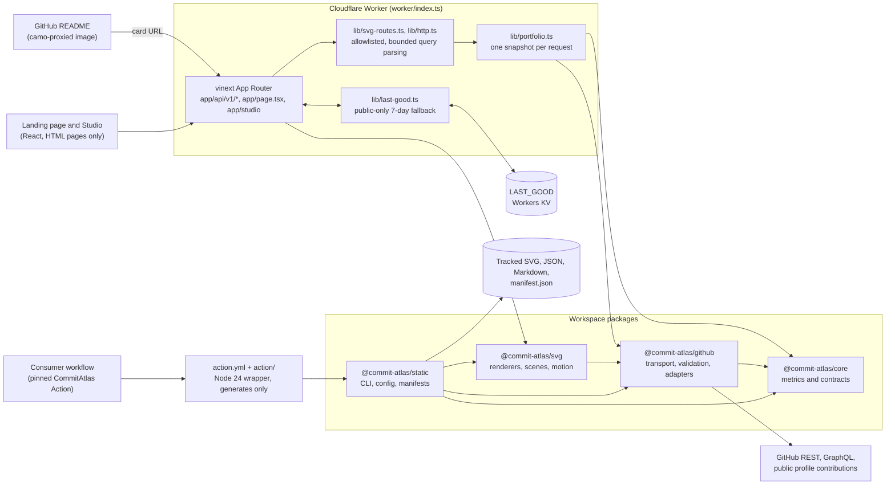

<div align="center">

# CommitAtlas

### Your GitHub work, mapped clearly.

Public GitHub evidence as accessible SVG cards and a project board, with every number labelled by source, window, and freshness.

[](https://github.com/Chris0Jeky/CommitAtlas/actions/workflows/ci.yml)
[](https://github.com/Chris0Jeky/CommitAtlas/actions/workflows/deploy.yml)
[](LICENSE)
[](package.json)
[](tsconfig.json)

[Open the live Studio](https://commit-atlas.commit-atlas.workers.dev/studio) ·
[Run the demos](docs/DEMO_GUIDE.md) ·
[Product direction](docs/PRODUCT_DIRECTION.md) ·
[Project state](docs/PROJECT_STATE.md)

</div>

## What it is

CommitAtlas is a TypeScript toolkit that turns public GitHub activity into things you can put on a profile: SVG cards, a project-health board, and a static generator for when you would rather commit the files than call an API at render time. The hosted part runs on a Cloudflare Worker and needs no credentials. The static part is a CLI and a GitHub Action that only write files.

It is the public presentation layer of a wider set of tools. Developer Lens owns private, local analysis. Pulseboard owns private operational evidence. Your profile repository owns the final choice of what gets published.

### Why it exists

The stat generators I surveyed in [docs/RESEARCH.md](docs/RESEARCH.md) fall into a few patterns. Some rank you on a band or trophy scale. Some tell you to self-host, because their shared public endpoint is not reliable. Some expose a configuration surface large enough to need its own documentation. CommitAtlas takes the opposite position on each.

It uses public data only, states the window and freshness of every reading, shows unknowns as unknowns, and never produces a comparative score. Rhythm is a consistency summary inside the window you asked for, not a rank.

## Features

**Hosted cards and API (credential-free)**

- Eight SVG cards at `/api/v1/cards/*.svg` and `/api/v1/projects.svg`: Atlas, Profile, Streak, Breakdown, Rhythm, Activity, Languages, and Projects.
- Atlas renders an `860 × 380` wide layout or a `480 × 570` compact one. It covers a 7 to 730 day window, or `days=auto` for the full observed history up to two years. It shows the contribution heatmap, streaks, the public collaboration mix, twelve weekly momentum buckets with a 28-day change, language share, and configured project health.
- Projects covers one to six public repositories. Each shows its declared lifecycle, the CI state of its named workflow bound to the observed default-branch head, the latest release, and freshness. Individual action links stay in HTML, because an image in a README is a single link.
- Four hosted scene routes at `/api/v1/scenes/<id>.svg` for `activity-terrain`, `chronograph`, `evidence-coverage`, and `lifecycle-map`, using the survey pack.
- JSON routes at `/api/v1/profile`, `/api/v1/contributions`, `/api/v1/projects`, and `/api/v1/health`.
- `demo=true` on the SVG and JSON routes returns deterministic synthetic data and makes no GitHub request.
- Motion is `none`, `subtle`, or `ambient` on hosted routes. Atlas defaults to `subtle` and the other cards to `none`. On the cards, subtle and ambient currently emit identical bytes. The scene routes do differ between them. `cinematic` is available only to the package and static generator.

**Truthful by default**

- Missing, partial, stale, restricted, and unconfigured evidence is never shown as healthy or passing. A project without a declared workflow shows as unconfigured, not green.
- Anonymous hosted requests that hit a GitHub `429` or `502` can fall back to a validated public response for up to seven days. That response is marked stale, timestamped, and cached briefly. Cold, expired, demo, token-backed, and mismatched requests never borrow it. The fallback lives in a Workers KV namespace.
- Upstream failures keep distinct meanings: a missing resource returns `404` without saying whether it is absent or private, rate limits return `429` with retry guidance, and everything else returns `502`.

**Static generator and GitHub Action**

- `@commit-atlas/static` and the root `action.yml` generate files from one snapshot. You can select up to eleven card types: the eight hosted cards plus Cadence, Releases, and the opt-in Delivery card. The default is ten, and Delivery needs a short-lived token.
- The same snapshot can render an alternate Atlas layout for responsive `<picture>` use, plus `projects.json` and `projects.md`. Dark and light variants come from one fetch through `themes` entries, and each output directory gets its own `manifest.json` with byte sizes and SHA-256 hashes.
- Config is a single tracked `.commitatlas.json` for one public owner. It rejects unknown fields, credentials, traversing or symlinked paths, and invalid workflow identities.
- Neither the CLI nor the Action commits, pushes, uploads, or deploys. The consumer workflow owns publication, and a failed refresh leaves the last committed assets in place.

**Studio**

- An interactive configurator for projects, cards, theme, layout, and motion. It previews against a synthetic or live public snapshot, shows provenance and freshness for each card, and generates README Markdown with dark and light `<picture>` pairs.
- Copying Markdown is enabled only after a preview on the deployed HTTPS origin. Local previews stay local.

**Other surfaces**

- Developer Lens research explainer on the landing page. It shows one pinned, invented offline trial with its limitations and unsupported claims, and it is not profile evidence.
- Optional usage measurement on the two HTML pages only, through a first-party Pulseboard SDK. See [Usage measurement](#usage-measurement).

## Try it

These demos use synthetic data and make no GitHub request, so they separate renderer behaviour from upstream availability:

- [Rich Atlas demo](https://commit-atlas.commit-atlas.workers.dev/api/v1/cards/atlas.svg?user=octocat&demo=true&theme=ember&days=365&motion=subtle&layout=wide)
- [Profile demo](https://commit-atlas.commit-atlas.workers.dev/api/v1/cards/profile.svg?user=octocat&demo=true&theme=paper&motion=none)
- [Project board demo](https://commit-atlas.commit-atlas.workers.dev/api/v1/projects.svg?owner=octocat&repos=Hello-World%2CSpoon-Knife&states=Hello-World%3Aactive%2CSpoon-Knife%3Amaintenance&demo=true&theme=paper&motion=none)

The [live Atlas for `Chris0Jeky`](https://commit-atlas.commit-atlas.workers.dev/api/v1/cards/atlas.svg?user=Chris0Jeky&demo=false&theme=ember&days=365&motion=subtle&layout=wide) reads GitHub on every request. It depends on anonymous GitHub availability and has returned `502` recently ([#338](https://github.com/Chris0Jeky/CommitAtlas/issues/338)). A retained public response, if one exists, carries a visible `STALE SNAPSHOT` strip.

## Architecture



| Path | What it is |
| --- | --- |
| `app/` | Landing page, Studio, and the `/api/v1` route handlers |
| `lib/` | Worker-side glue: query parsing, the portfolio snapshot, the last-good cache, HTTP helpers, and page models |
| `worker/index.ts` | Worker entry point. It routes image-optimizer requests, binds `LAST_GOOD`, and reads runtime configuration |
| `packages/github` | Hardened GitHub REST and GraphQL client, input validation, and adapters |
| `packages/core` | Contribution metrics: density, streaks, momentum, rhythm, and language share |
| `packages/svg` | Accessible SVG renderers, the scene registry, and the motion compiler |
| `packages/static` | Credential-free CLI, config validation, manifest writer, and project catalogs |
| `action.yml`, `action/` | GitHub Action wrapper around `@commit-atlas/static`, bundled with `ncc` |
| `observatory/`, `public/pulseboard.js` | Pulseboard SDK, hash-locked by `observatory.lock.json` |
| `research-contracts/` | Vendored Developer Lens C0 summary, validated at test time |
| `docs/` | Contracts, plans, and dated QA and evidence receipts |

Packages are workspace members. They are built and pack-verified from source and are not published to npm.

## Quickstart

You need Node.js 22.13 or newer and npm. CI runs on 22.13.0 with the committed lockfile.

```bash
git clone https://github.com/Chris0Jeky/CommitAtlas.git
cd CommitAtlas
npm ci
npm run dev
```

Vite serves the app at `http://localhost:5173`. Synthetic routes work without any token:

```bash
curl -s "http://localhost:5173/api/v1/cards/atlas.svg?user=octocat&demo=true&theme=ember&days=365&motion=subtle&layout=wide" -o atlas.svg
```

Run the full local gate with:

```bash
npm run check
```

It runs the Worker type check, TypeScript, ESLint, the observatory and deploy-tooling tests, the core, GitHub, Studio, SVG, static, and Action suites, the packaging check, and the production build.

To run the production build locally:

```bash
npm run build
NODE_OPTIONS="--import=./tests/register-cloudflare-workers-loader.mjs" npm run start
```

On Node 22.14, `npm run start` without the `--import` flag fails with `ERR_UNSUPPORTED_ESM_URL_SCHEME` on the `cloudflare:` import. With the flag, the server listens on `http://localhost:3000`.

### Generate static profile assets

The static generator reads GitHub's logged-out public profile view and public REST endpoints. It needs no token for the default cards.

```bash
cp .commitatlas.example.json .commitatlas.json   # edit user and projects first
git add .commitatlas.json                         # the config must be tracked by git
npm run build:static
node packages/static/dist/cli.js generate --config .commitatlas.json --dry-run
```

Every project must be a public repository owned by the configured user. The example config lists repositories that are not visible to anonymous requests, so edit it before running. Anonymous GitHub requests are rate-limited, so a run can fail with a rate-limit error. The CLI reports that instead of writing partial output. Drop `--dry-run` to write files, and use `--output-dir` to choose where they go.

The Action takes the same config and output options and never commits. Pin it to a full commit SHA and let your workflow own the checkout and any commit step:

```yaml
- uses: Chris0Jeky/CommitAtlas@<full-commit-sha>
  with:
    github-token: ${{ github.token }}  # only needed when the Delivery card is selected
```

Read [packages/static/README.md](packages/static/README.md) for the config contract and [STATIC_GENERATOR_PLAN.md](docs/STATIC_GENERATOR_PLAN.md) for the full contract.

### Deploy your own

The Worker needs no secrets to serve its documented surfaces. Deploying a fork takes a few steps:

```bash
npx wrangler login
npx wrangler kv namespace create commit-atlas-last-good
# Put the returned namespace id into the LAST_GOOD binding in wrangler.jsonc.
# Set vars.SITE_ORIGIN to your own origin, so canonical URLs and the sitemap point at your deployment.
npm run deploy
```

Namespace IDs belong to one Cloudflare account, so the checked-in `LAST_GOOD` ID will not work for a fork. `npm run deploy` builds first, then deploys and probes the origin Wrangler reports. Never run a bare `wrangler deploy` on an unbuilt checkout. It would replace a working deployment with one that serves no client assets.

If you want higher anonymous limits, add a public-only classic token with `npx wrangler secret put GITHUB_TOKEN`. Do not commit it, and do not put it in a URL.

Full details are in [docs/DEPLOYMENT.md](docs/DEPLOYMENT.md).

### Scripts

| Script | What it does |
| --- | --- |
| `npm run dev` | Local development server on port 5173 |
| `npm run build` | Production build of the Worker, its assets, and the deploy config |
| `npm run typecheck` | `tsc --noEmit` for the root project |
| `npm run lint` | ESLint over the repository |
| `npm test` | Builds the app, then runs the server-bundle, rendered HTML, rendered SVG, and discoverability tests |
| `npm run check` | The full gate. CI runs this, then `npm audit --omit=dev --audit-level=high` |
| `npm run build:static` | Builds `@commit-atlas/static` |
| `npm run build:action` | Rebuilds the bundled Action in `action/dist` |
| `npm run deploy` | Build, deploy, and verify the Worker |
| `npm run verify:deployment` | Runs the deployed-origin probes against a given URL |

## Tech stack

- **Language and types:** TypeScript 5.9 in `strict` mode, with Zod 4 for config and input schemas.
- **Web:** React 19, vinext 1.1 on Vite 8, and Tailwind CSS 4 through PostCSS. Routes use the App Router layout.
- **Runtime:** Cloudflare Workers with static assets, a `LAST_GOOD` Workers KV namespace, and Wrangler 4. The Worker runs with `nodejs_compat`.
- **Rendering:** hand-written SVG with XML-escaped text, one hue per quantitative scale, and a deterministic seed for scenes.
- **GitHub integration:** the REST and GraphQL APIs, with bounded responses, deadlines, GitHub-only outbound hosts, and token-scope checks.
- **Static and Action:** a Node CLI, with `@vercel/ncc` producing the Action bundle that runs on Node 24.
- **Testing:** `node:test`, Vitest for the core package, and `tsx` for TypeScript suites. Browser harnesses for the Studio and motion checks use Playwright and are optional.
- **Quality:** ESLint 9 with `typescript-eslint`, `eslint-plugin-react-hooks`, and `jsx-a11y`. Dependabot is configured in `.github/dependabot.yml`.
- **Telemetry (opt-in):** Pulseboard SDK 3.3.1, loaded only on the HTML pages.

## Status and roadmap

**Released:** [v0.4.0](https://github.com/Chris0Jeky/CommitAtlas/releases/tag/v0.4.0), marked latest. The root package is `0.4.0`. The workspace packages stay at `0.1.0` because they are source-installed and their public APIs have not moved.

v0.4.0 includes:

- **Last-good resilience.** Eligible public responses survive a short anonymous GitHub outage, with a visible stale marker.
- **Contribution fidelity.** The contribution grid is aligned to GitHub's Sunday rows and keeps GitHub's intensity levels. An open final UTC day no longer breaks a continuing streak.
- **One snapshot, two schemes.** Dark and light outputs share a source time and window and keep independent manifests.
- **Readable product surface.** The Studio separates hosted routes, static cards, source distribution, and the optional design explainer.
- **Bounded research bridge.** One pinned Developer Lens C0 summary, with its unsupported claims printed next to it.

**Known gaps**

- **Live anonymous reads are intermittent.** Live requests can return `429` or `502`. A profile that needs a stable image should use the committed static output as its fallback. [#338](https://github.com/Chris0Jeky/CommitAtlas/issues/338) tracks live routes for one user returning `502`. Demo routes are unaffected.
- **Card motion is not yet differentiated.** Subtle and ambient render the same bytes on the hosted cards. The GitHub raw and Camo rendering matrix is tracked in [#113](https://github.com/Chris0Jeky/CommitAtlas/issues/113). WebKit delivery is parked in [#180](https://github.com/Chris0Jeky/CommitAtlas/issues/180).
- **Cinematic motion is not hosted.** Whether to host it is an open decision in [#167](https://github.com/Chris0Jeky/CommitAtlas/issues/167).
- **Languages show repository counts.** The Languages card reports the share of public repositories by primary language. It is not byte share, and it does not measure skill.
- **Not on npm, not on the Marketplace.** The packages and Action are built from source and pack-verified. Neither registry publication nor a Marketplace listing is claimed.

**Planned, not shipped:** differentiated ambient and cinematic motion for the cards, further scenes and their static artifacts, owner-reviewed Developer Lens projections, and crash-safe multi-theme static publication. The programme and its issue map are in [EXPANSION_PLAN.md](docs/EXPANSION_PLAN.md) under tracking issue [#111](https://github.com/Chris0Jeky/CommitAtlas/issues/111). The Developer Lens C1 projection is waiting on owner decision [#170](https://github.com/Chris0Jeky/CommitAtlas/issues/170). [PROJECTION_CONTRACTS.md](docs/PROJECTION_CONTRACTS.md) holds the consumer-side specification.

## Evidence model

CommitAtlas keeps four kinds of information visibly separate:

1. **Observed facts.** Values taken directly from the declared public source.
2. **Derived readings.** Transparent calculations over those facts, such as density, momentum, and the rhythm summary.
3. **Configured intent.** Owner-declared lifecycle, named workflow, or approved project links.
4. **Missing or stale evidence.** Unavailable, restricted, expired, unsupported, or served from a marked last-good snapshot.

A scene may later use evidence as a deterministic seed, but a visual effect never carries an unstated claim. Everything stays readable at frame zero. Unavailable evidence never animates as healthy. Identical inputs produce byte-identical output.

## Public data and privacy boundary

Credential-free cards use GitHub's logged-out public profile and public REST data. That profile view can include anonymous aggregate private-contribution counts that the user chose to display. CommitAtlas requests no private repository names, commits, URLs, or other private detail.

Some activity-mix values come from calendar-year profile percentages, not from the requested window. CommitAtlas labels them as percentages and never converts them into counts. A signed-in owner may see different totals, because GitHub exposes a different boundary. Compare against a logged-out profile when you check parity.

A hosted deployment can optionally use a server-side classic token that proves public-only scopes. The client rejects broader, fine-grained, App, Actions, unknown, and restricted-data credentials. Tokens never go in a URL, a browser setting, a fixture, a manifest, a generated SVG, or a tracked config. The landing page and Studio never send typed handles, repository names, or URLs to the usage collector.

Developer Lens projections are a separate publication boundary. The hosted product never fetches private or local evidence. A future owner projection has to be explicitly redacted, reviewed, committed by the owner, freshness-checked, and labelled as a derived signature. It must not be inferred silently from GitHub.

## Usage measurement

The two HTML pages, `/` and `/studio`, and the 404 page that shares their layout load a first-party copy of the [Pulseboard](https://github.com/Chris0Jeky/Pulseboard) SDK. A one-line Beta bar says what is collected and why. Three switches control it:

- **Usage counts.** Daily aggregate counts per route bucket (`home`, `studio`, `other`) and product event, with coarse device, referral, and colour-scheme totals. On by default.
- **Diagnostics.** Web-vital timings, JavaScript error summaries, and visible time and scroll depth. On by default outside the EEA. Inside the EEA, or when the region is unknown, it stays off until you click OK.
- **Journeys and product data.** A random id for one browser tab session and a small set of product events, such as `studio.opened`, `profile.loaded` with a bucketed repository count, and `card.exported` with its format and theme. Same default as Diagnostics.

Global Privacy Control or Do Not Track turns every category off. Pulseboard stores no IP address, user agent, page URL, or cross-site identifier. The SVG cards and JSON routes never load it, so camo-proxied README images carry no script. Retention, the collector boundary, and the hash-lock check are described in [observatory/README.md](observatory/README.md).

## Architecture decisions worth knowing

- **One snapshot per render.** The static generator renders a card's alternate layout and its dark and light variants from one fetched snapshot, so they never disagree about the window or the time. A hosted SVG request builds one snapshot for its response.
- **Renderers take plain data.** `@commit-atlas/svg` takes presentation data and returns a complete SVG string. Scripts, `foreignObject`, remote images, and event attributes are never emitted.
- **Project actions are HTML.** A README image is one link, so the Studio exposes Source, Docs, Install, Download, and CI as separate keyboard-accessible HTML links.
- **Freshness is part of the response.** Responses carry the data state in headers and metadata, and the SVG marks stale data visibly.

## Documentation

- [Product direction](docs/PRODUCT_DIRECTION.md)
- [Architecture and security boundaries](docs/ARCHITECTURE.md)
- [Live project state](docs/PROJECT_STATE.md)
- [Expansion programme](docs/EXPANSION_PLAN.md) and [projection contracts](docs/PROJECTION_CONTRACTS.md)
- [Deployment](docs/DEPLOYMENT.md) and [static generator plan](docs/STATIC_GENERATOR_PLAN.md)
- [Design chassis and evidence ladder](docs/DESIGN_CHASSIS.md)
- [Evidence coverage scene](docs/EVIDENCE_COVERAGE_SCENE.md)
- [Competitive research](docs/RESEARCH.md)
- [Demonstration guide](docs/DEMO_GUIDE.md) and [Studio production QA](docs/STUDIO_QA_2026-08-20.md)

### Static scene configuration

Static config v1 accepts `scenes: []`, `scenePack: "survey"`, and an optional bounded `identity` text. The defaults keep existing card artifacts unchanged. Only registered scenes can be selected. `evidence-coverage` is the first production definition. It shows observed coverage and names unavailable sources. Selected scenes render from one snapshot for each configured theme, and their hashes go into the existing manifest. The Action's `scenes` output lists the generated paths, as a JSON array, and is `[]` when scenes are disabled, including in a dry run.

```json
{ "scenes": ["evidence-coverage"], "scenePack": "survey" }
```

Add these fields to an existing complete config, and add each `scene-<id>.svg` name to any exact artifact allowlist in your consumer workflow before you enable it. See [the scene delivery contract](docs/STATIC_GENERATOR_PLAN.md#registered-scene-delivery) for identity limits and ownership rules, and the [evidence coverage guide](docs/EVIDENCE_COVERAGE_SCENE.md) for the input-to-row mapping.

## Contributing, security, and conduct

- **Contributing.** Read [CONTRIBUTING.md](CONTRIBUTING.md) before you open a pull request. The short version: keep changes focused, add a fixture and a focused test for every metric, renderer, or GitHub response shape, and run `npm run check`. Do not add inferred health scores, proficiency claims, or green fallbacks for unknown CI state.
- **Security.** Report vulnerabilities through the repository's private reporting option under the Security tab, not a public issue. [SECURITY.md](SECURITY.md) lists the supported versions and the deployment responsibilities for self-hosters.
- **Conduct.** The community follows the [Code of Conduct](CODE_OF_CONDUCT.md).

## License

CommitAtlas is licensed under [GPL-3.0-only](LICENSE). The workspace packages carry the same license.
