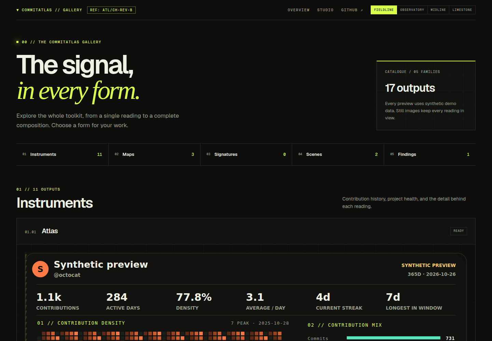
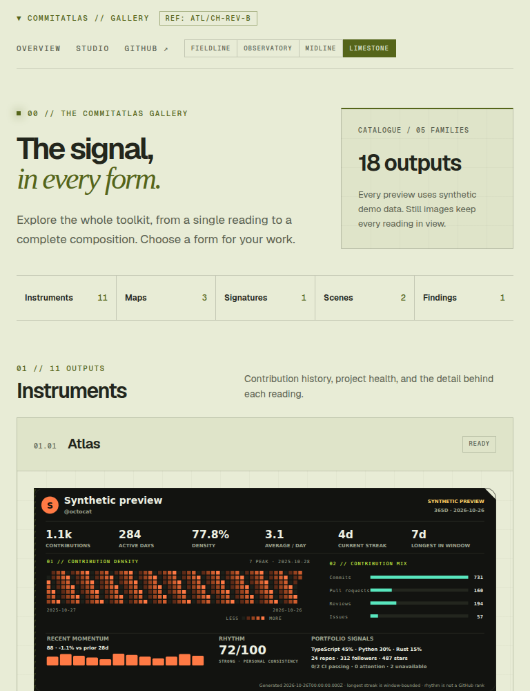
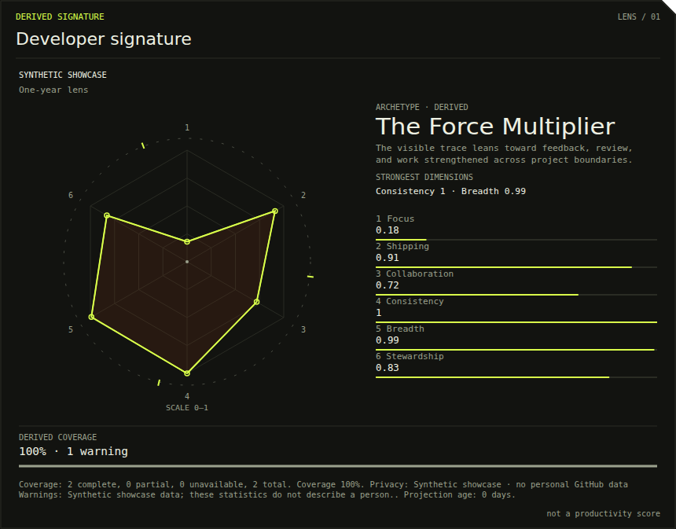
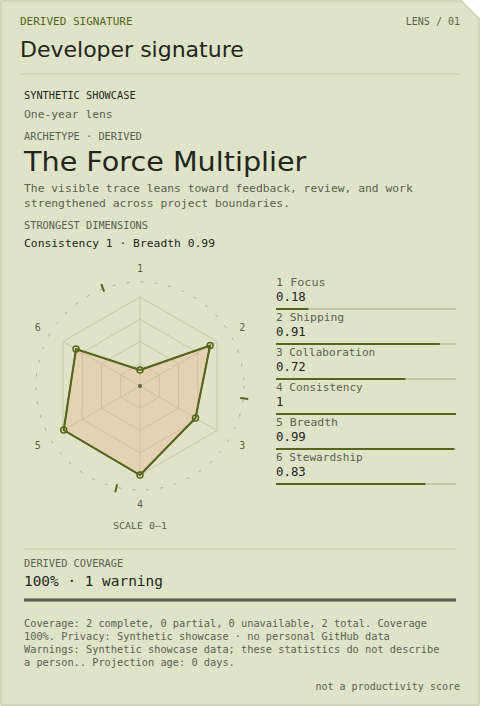

# Appearance reference captures — 2026-10-26

These are actual Chromium screenshots of synthetic output, retained with the source so the
design can be reviewed after workflow artifacts expire. They are visual references, not
GitHub/Camo transport evidence or personal profile publications.

## Gallery

The built-Worker capture is from the clean PR #448 head
`703ea90097080327513b29cbe7d3c321680576ee`, using Chromium 143.0.7499.4 and Playwright 1.57.0.
The [appearance run](https://github.com/Chris0Jeky/CommitAtlas/actions/runs/40400659546) measured
six layouts and exercised family navigation, keyboard focus, reduced-motion chrome and Studio
preselection. This capture shows the 17-output catalogue before Signature was registered.
The merged build `c72c3b2` subsequently passed all 21 deployed-origin checks in the
[deployment run](https://github.com/Chris0Jeky/CommitAtlas/actions/runs/40401782765).

### Current Gallery after Signature

This later image is the unmodified `768 × 1000` PNG from clean native head
`b5c3df2200686e554b73a3229ccd615d8f3fd8dd`, captured by
[appearance run 40403676093](https://github.com/Chris0Jeky/CommitAtlas/actions/runs/40403676093).
The built-Worker synthetic HTTPS capture uses Chromium 143.0.7499.4 and Playwright 1.57.0 and
waits for finite theme transitions to settle. The catalogue now contains 18 outputs, including
one Signature. All six viewport/theme layouts pass without overflow. This 115,259-byte PNG is
from artifact `12689892016`; its hash is recorded below. The earlier 17-output Gallery image and
its #448 deployment receipt remain historical references.

## Developer Signature

Both images use renderer source `1dd7339a16783c7640e5b8276406d9dd777fe0c1` and the same pinned
Chromium/Playwright versions. They show the authentic C0 showcase fixture at an explicitly
fresh synthetic snapshot clock. The fixture's own `2026-09-01T12:00:00Z` timestamp is unchanged.
The Gallery uses its actual snapshot clock, so its current historical example is labelled Stale
and stays still. These reference images do not imply that historical data was refreshed.

The local capture run measured 312 layouts across four themes, two widths and three real font
families, including CJK and emoji glyphs. Fourteen direct-image playback/control rows produced
56 timed PNGs. Both CSS and SMIL moved visibly and returned pixel-exactly to the still twin after
46 seconds; none, stale, expired and explicitly selected reduced-motion twins stayed static.
The largest observed capture lateness was 698.3 ms within a 1500 ms bound. Requested zero means
the first load-relative observation, not an exact animation frame. Four WebM recordings have
verified hashes and container signatures; their container durations were not parsed.

That local run had only its new harness untracked; it was a development receipt rather than a
clean-head CI receipt. Final integration qualification uses
[`signature-browser-evidence.yml`](../../../.github/workflows/signature-browser-evidence.yml),
which checks out the exact PR head, builds the packages, records source and built-module hashes,
and retains fresh screenshots, recordings, timings, actual browser/font identities and failures.
Its run and the repository quality gate are linked from the implementation PR.
The later [clean native CI receipt](../../SIGNATURE_EVIDENCE.md) now records the merged #449
qualification, including its own actual font selections and 760.9ms maximum capture lateness.
The source and measurements above remain the earlier local development receipt.

## Image integrity

| File | SHA-256 |
| --- | --- |
| `gallery-fieldline.png` | `cd7b70060d62677ca5dcac3a79f91502b3682743f4fd4ace5a194952162f6967` |
| `gallery-768-limestone.png` | `83a06603135b3e2546fa5b26ee036fd817bcbc863eef7fc8fd187942e3d28a7a` |
| `signature-ember-wide.png` | `cff5f32c91ebb3b395c71208cc7f0242edea0b256effba59cfe21bb5d8b8e29a` |
| `signature-paper-compact.png` | `4230fba033484dfca4e9138194cb13df04c097b3d7de4943882db084be9931d7` |

The [Signature guide](../../SIGNATURE_SCENE.md) explains the data, freshness and motion contracts.
